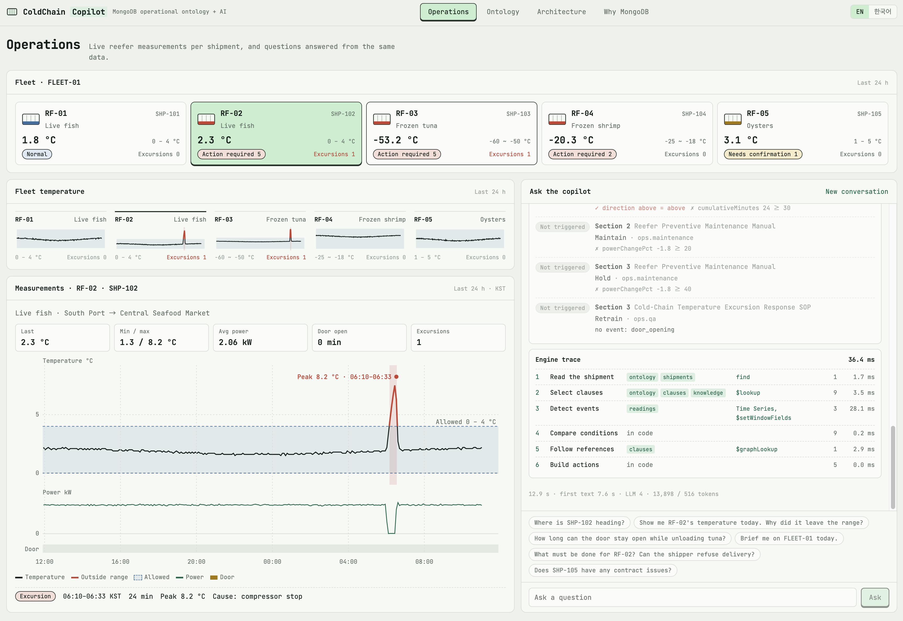
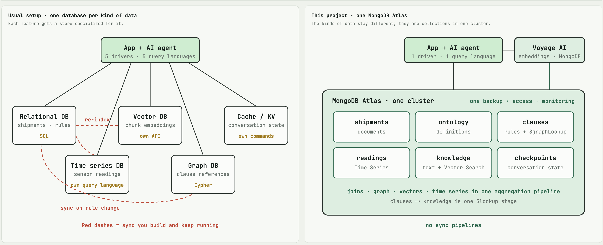
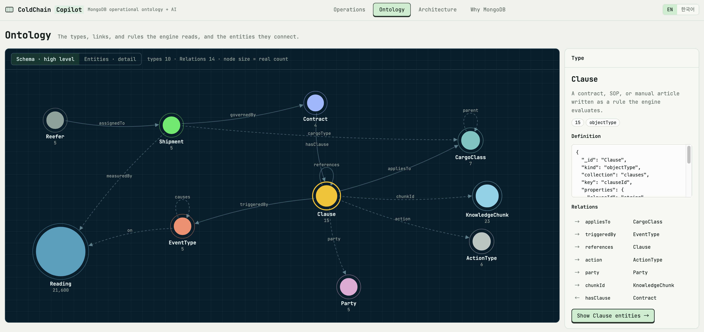
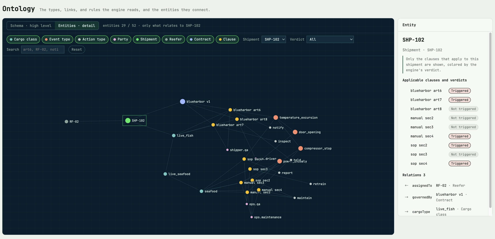
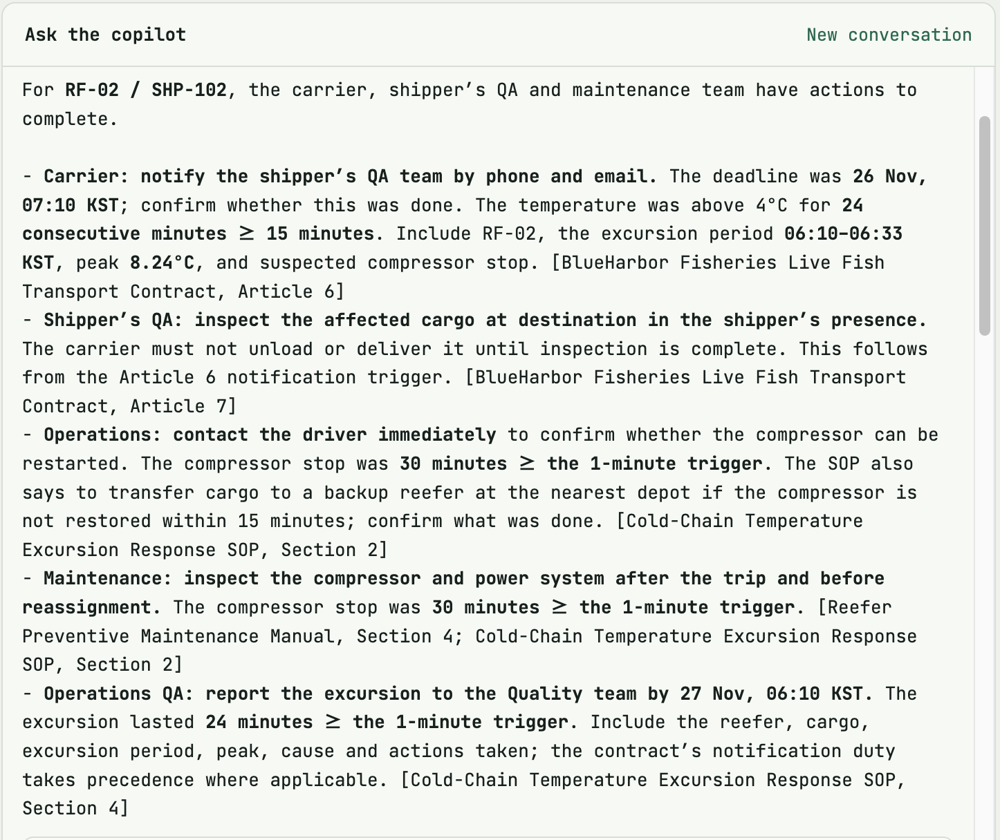
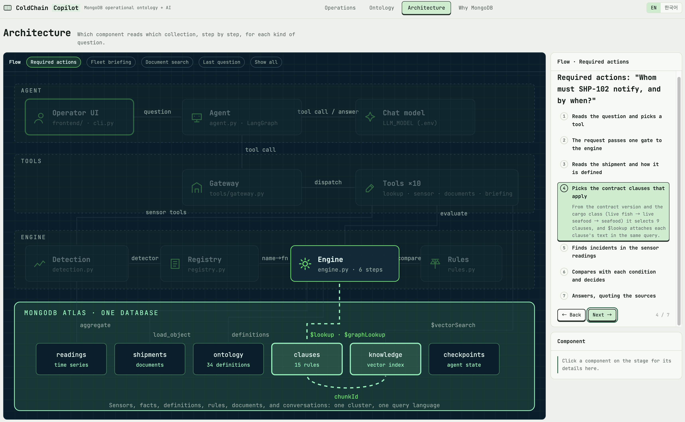

# ColdChain Copilot

An operations agent for cold-chain logistics. It reads reefer sensor data, checks it against shipper contracts and SOPs (standard operating procedures), and tells operators **what happened and what to do next**.

*MongoDB Solo Project · Time Series × Vector Search × Ontology × LLM tool calling*



```text
> Brief me on today's data.
  ↳ find_excursions({"fleet_id": "FLEET-01", "hours": 24})
  ↳ find_energy_anomalies({"fleet_id": "FLEET-01", "hours": 24})
  ↳ evaluate_obligations({"shipment_id": "SHP-102"})
  ↳ ...

Action Required
· [RF-02 / SHP-102] Notify BlueHarbor QA by 10:12 — 24 consecutive min above 4°C (≥ 15)
  [BlueHarbor Live Fish Contract v1 § Art. 6]
· [RF-02 / SHP-102] Quality inspection before unloading — follows from Art. 6
  [BlueHarbor Live Fish Contract v1 § Art. 7]

Needs Confirmation
· [RF-05 / SHP-105] Humidity clause cannot be checked — humidity is not collected
  [TidalPearl Oyster Contract v1 § Art. 5]

Suggestion
· [RF-02] Inspect compressor and power system before reassignment  [Maintenance Manual § 4]
```

---

## 1. What It Does

Each reefer (refrigerated container) reports temperature, compressor power, and door status every minute. Detecting a threshold breach is easy. The real work comes after:

- **Why** did it happen — compressor stop or an open door?
- What does **this shipper's contract** require, and by when?
- What do **SOPs and maintenance manuals** recommend?
- Which equipment is **about to fail**, even if nothing has happened yet?

The facts live in sensor data; the rules live in documents. ColdChain Copilot connects the two, and handles questions at five levels on the same data:

| Level | Example question | How it is answered |
|---|---|---|
| 1 · Lookup | *Where is SHP-102 going?* | Shipment document |
| 2 · Sensor analysis | *Which readings exceeded their range today?* | Time Series aggregation |
| 3 · Document search | *How long may the door stay open while unloading tuna?* | Vector Search (RAG) |
| 4 · Facts + evidence | *Brief me on today's data.* | Levels 2 + 3 + 5 combined |
| 5 · Rule decisions | *What must we do for RF-02? Could they refuse delivery?* | Ontology: clauses as rules |

```text
 Question ──▶ LLM agent (chooses tools, repeats as needed)
                 │
   ① Detect     readings    aggregation      → "RF-02: 24 consecutive min above 4°C"
   ② Scope      shipments   find             → SHP-102 → BlueHarbor contract v1
   ③ Decide     clauses     rule evaluation  → Art. 6 triggered (24 ≥ 15)
                            $graphLookup     → Art. 7 depends on Art. 6 → triggered
   ④ Quote      knowledge   $vectorSearch    → source text of each clause
                 │
   ⑤ Explain    LLM writes Action Required / Needs Confirmation / Suggestion
```

### Design Principles

1. **The database calculates; the LLM explains.** Sensor facts come from aggregation. The LLM never counts raw readings.
2. **Rules are data.** Whether a clause applies is decided by comparing named measures with structured conditions, not by the LLM reading a sentence.
3. **Evidence comes from the right contract.** Clauses are used only from the contract version assigned to the shipment.
4. **No evidence, no conclusion.** If the data or clause needed for a decision is missing, the answer is "needs confirmation" — never "no obligation."

---

## 2. Why MongoDB

Every answer this agent gives combines sensor facts, shipment context, contract rules, and contract text. The usual build puts each in its own store (relational, time series, vector, graph, cache) and then keeps them in sync. Here they are collections in one MongoDB Atlas cluster, so a verdict and its evidence come from one query path instead of an integration between systems.



Each kind of data is modeled for the question it has to answer, and a specific MongoDB feature carries that model:

| Data | Problem | Model | MongoDB provides |
|---|---|---|---|
| Sensor readings | "Above 4 °C for 15 consecutive minutes" depends on order and continuity | One reading per document; shipment, reefer, and allowed range in `meta`; incidents computed, not stored | Time Series collections; `$setWindowFields` + `$shift` to split runs |
| Contract rules | Clauses come in different shapes | One clause per document, in its own shape (`trigger`, `action`, `deadline`, `chunkId`) | Flexible schema; multikey indexes |
| Ontology | Knowledge about types and causes scattered in code | Types, links, events, actions as documents; functions by name only | Definitions next to the data; ancestor arrays with `$in` |
| Verdict + text | A verdict needs exactly its clause's text | Clause names its chunk by `chunkId` | `$lookup` in the same aggregation |
| Clause references | "If Art. 6 applies, Art. 7 too" | `references` array | `$graphLookup` |
| Document search | Unknown document; other shippers' contracts must stay out | Chunk = text + embedding + owner metadata | Voyage AI embeddings; `$vectorSearch` with a metadata filter |
| Conversations | Follow-ups need earlier results | Checkpoint documents per thread | LangGraph `MongoDBSaver` |

What MongoDB does not do here: the LLM writes answers, application code (`rules.py`) decides whether a clause triggers, and no actions are carried out (the demo is read-only).

The full story, with the costs of the five-store setup, the limits of RAG alone, document examples, and diagrams: [`design/why-mongodb.md`](./design/why-mongodb.md). Field-level schemas and tradeoffs: [`design/entities.md`](./design/entities.md) and [`design/decisions.md`](./design/decisions.md).

---

## 3. From Retrieval to Decisions: Why an Ontology

In the five question levels of [§ 1](#1-what-it-does), RAG covers level 3, document search: *"what does the contract say?"* A briefing also needs level 5, rule decisions: *"what must we do, and by when?"* That is a judgment, and in this domain a wrong one has a cost: a missed notification deadline means paying for the freight and the lost cargo. An ontology is what turns retrieved text into decisions the system can make consistently.

### What happens with RAG alone

(The six limits, side by side with how this project handles each, are in [`design/why-mongodb.md` § 2](./design/why-mongodb.md#2-why-rag-alone-is-not-enough).)

RAG finds contract passages that look similar to the question, shows them to the LLM, and lets the LLM read them and answer. It is like pulling a few pages that seem relevant out of a contract and handing them to a new hire to decide. Ask about RF-02 (above 4°C for 24 minutes in a row), and three things can go wrong.

**1. It misses a clause it should have found.**
Ask "do we need to notify the shipper?" and it finds Article 6, which contains the word "notify." But Article 7 only says "if Article 6 applies, inspect the cargo before unloading," with nothing like "notify" in it. It can be left out of the search, and the cargo gets unloaded without inspection.

**2. The same question gets different answers.**
Article 6 requires "15 consecutive minutes or more"; Article 8 requires "30 cumulative minutes or more." Because the LLM decides by reading the sentences which one 24 minutes falls under, the answer can change from one run to the next. Sometimes it may wrongly say "delivery could be refused."

**3. It says "no problem" when it simply does not know.**
The oyster contract requires humidity checks, but the reefer has no humidity sensor. With no data to check, the LLM tends to summarize it as "nothing unusual." In reality nothing was checked, yet it looks like a clean result.

### With the ontology

An ontology is close to a rulebook prepared from the contract in advance. For each clause it stores, as data, when it applies, what must be done, and which clauses it is connected to.

1. Article 7 is stored as "connected to Article 6," so when Article 6 applies, Article 7 comes with it.
2. Conditions are stored as numbers, so the system just compares values. 24 minutes is at least 15, so Article 6 applies; it is under 30, so Article 8 does not. The answer is the same no matter how many times you ask.
3. When the data a decision needs is missing, it is marked separately as "needs confirmation."

The demo app shows the ontology from the database: the types and their relations, sized by real counts, and the entities around one shipment, colored by the engine's verdict.





The LLM still writes the briefing, and RAG is still used: it finds the source text of each decided clause to quote, and it answers questions no rule covers ("what should we watch for when unloading tuna?"). What changes is **who makes the decision**. Aggregation computes the numbers, rules decide the obligations, and the LLM explains the result.

### What MongoDB contributes to an AI ontology

- **Ontology and data in one place.** Classes, relations, and rules are documents next to `readings` and `shipments`. Evaluating a rule is an aggregation over the same data, with no export to a separate reasoner.
- **Semantic and structural retrieval in one pipeline.** `$vectorSearch` finds the clause a question means, `$lookup` attaches its rule, and `$graphLookup` follows its dependencies — a GraphRAG-style flow inside one aggregation.
- **Grounded context for the LLM.** Tools return decisions with their basis (fact, condition, source chunk). The LLM explains a result instead of inferring one, and the defined vocabulary keeps its tool calls and generated queries on known names.
- **Room to grow.** New clause kinds or measures are new fields in polymorphic documents, not schema migrations.

### Scope

The MVP keeps the ontology minimal: two class hierarchies (cargo, events), six relations, and one rule format, with clauses structured by hand. Clauses that do not fit the format stay as text and are cited, not decided. If decisions are low-stakes or a person reviews every answer anyway, RAG alone is enough; the ontology pays off when the same contract terms apply to many shipments every day.

---

## 4. Quick Start

**Requirements:** [uv](https://docs.astral.sh/uv/), MongoDB with Vector Search reachable at `MONGODB_URI`, and API keys for the embedding and chat model providers (by default Voyage AI and OpenAI).

```bash
uv sync
cp .env.example .env                 # set MONGODB_URI, VOYAGE_API_KEY, OPENAI_API_KEY

uv run scripts/seed.py               # validate the catalog; load shipments, ontology, clauses, 72 h of readings
uv run scripts/ingest_docs.py        # docs/ → one chunk per Article/Section → embeddings → knowledge + vector index
uv run pytest                        # unit tests; integration tests run when MONGODB_URI is reachable
uv run coldchain-copilot -q "Brief me on FLEET-01."
uv run coldchain-copilot             # interactive mode
```

| Variable | Example |
|---|---|
| `MONGODB_URI` | `mongodb://localhost:27017` |
| `DB_NAME` | `coldchain_copilot` |
| `EMBEDDING_PROVIDER` | `voyage` (or `openai`); rerun `ingest_docs.py` after a change |
| `EMBEDDING_MODEL` | `voyage-4` |
| `LLM_MODEL` | `openai:gpt-6.1-terra` (`provider:model`, any model with tool calling) |
| `LLM_REASONING_EFFORT` | `low` (optional; OpenAI models) |
| `VOYAGE_API_KEY` | your Voyage AI key |
| `OPENAI_API_KEY` | your OpenAI key |
| `MAX_WINDOW_HOURS` | `72` |
| `DATA_DIR` | `data` |
| `DOCS_DIR` | `docs` |

How MongoDB runs (Atlas, a local Atlas deployment, ...) is up to you; the project only reads these variables.

---

## 5. Demo

`seed.py` injects these situations relative to the time it runs. Rerun it if testing more than a day later.

| Reefer | Cargo (range) | Injected situation | Expected outcome |
|---|---|---|---|
| RF-02 | Live fish (0–4°C) | Compressor stops 30 min → ~24 min excursion | Notify within 1 h (Art. 6) → inspection (Art. 7). Refusal at ≥ 30 min (Art. 8) does **not** apply. |
| RF-03 | Frozen tuna (−60 to −50°C) | Door open 15 min during unloading → ~18 min excursion | Notify within 30 min, flesh-color inspection, 10-min door limit violated. |
| RF-04 | Frozen shrimp (−25 to −18°C) | Normal temperature, power rising over 24 h | Report equipment abnormality within 24 h, despite no excursion. |
| RF-05 | Oysters (1–5°C) | Normal temperature; contract also requires humidity | **Needs confirmation**: humidity is not collected. |
| RF-01 | Live fish (0–4°C) | Normal | — |

Try the levels in order:

1. *Where is SHP-102 going?*
2. *Show me RF-02's temperature today. Why did it go out of range?*
3. *How long may the door stay open while unloading tuna?*
4. *Brief me on today's data.*
5. *What must we do for RF-02? Could they refuse delivery?* · *Any contract issue for SHP-105?*

All companies, contracts, SOPs, and manuals are fictional demo material.

### Demo app

The same agent in a browser, in English or Korean, with four tabs: **Operations** (fleet, per-shipment measurements, chat), **Ontology**, **Architecture**, and **Why MongoDB**. Plan and progress: [`design/demo-app.md`](./design/demo-app.md).

```bash
uv run coldchain-copilot-web          # API on localhost:8000
cd frontend && npm install && npm run dev   # app on http://localhost:5173
```

Each answer streams in as it is written. Charts under the answer are chosen in code from the tools the agent called, not by the LLM, and every engine run shows its six steps: the collections it read, the MongoDB feature it used, and how long it took.



The Architecture tab steps through each kind of question. Here, step 4 of *Required actions*: the engine selects the applicable clauses and `$lookup` attaches their text from `knowledge`.



---

## 6. Project Structure

The code is in four layers, and imports go downward only (`tests/unit/test_layers.py`):

```text
 common      →  engine     →  tools      →  agent
 config         ontology      gateway       agent.py
 db             detection     lookup        cli.py
 errors         rules         sensor
 embeddings     engine        documents
                registry      adhoc
                catalog
                ingest
```

```text
coldchain-copilot/
├── data/                  Ontology, clauses, shipments, cargo defaults (JSON)
├── docs/                  Contracts, SOP, maintenance manual (RAG sources)
├── design/                Detailed design (see below)
├── scripts/
│   ├── seed.py            Validate the catalog, load it, simulate 72 h of readings
│   └── ingest_docs.py     Chunk and embed docs/ into knowledge, build the vector index
├── src/coldchain_copilot/
│   ├── config.py · db.py · errors.py
│   ├── embeddings.py      Embedding providers chosen by EMBEDDING_PROVIDER (the only embedding SDK imports)
│   ├── catalog.py         Check every name used by clauses and the ontology
│   ├── ontology.py        Cargo classes, applicable clauses, dependent clauses ($graphLookup)
│   ├── detection.py       Detector functions (MongoDB aggregation on readings)
│   ├── rules.py           Compare clause conditions with detected measures
│   ├── registry.py        Ontology function names → functions
│   ├── engine.py          Evaluate one shipment: clauses → detect → compare → follow → act
│   ├── ingest.py          Documents → one chunk per Article/Section → embeddings
│   ├── tools/             The LLM's 10 tools; gateway.py is its only entrance
│   │   ├── gateway.py     Tool schemas, dispatch, error and time serialization
│   │   ├── lookup.py      get_shipment
│   │   ├── sensor.py      find_excursions, find_energy_anomalies, get_fleet_overview, get_reefer_timeline
│   │   ├── documents.py   search_knowledge ($vectorSearch), get_clause
│   │   ├── briefing.py    evaluate_obligations, collect_fleet_briefing
│   │   └── adhoc.py       run_aggregation (guarded)
│   ├── agent.py           LangGraph agent (llm ⇄ tools, MongoDBSaver checkpoints)
│   └── cli.py             Terminal chat: uv run coldchain-copilot
└── tests/                 unit/ (no database) · integration/ (MongoDB with seed data)
```

Start with [`design/architecture.md`](./design/architecture.md), then [`design/walkthrough.md`](./design/walkthrough.md). The others are references.

| Design document | Answers |
|---|---|
| [`design/architecture.md`](./design/architecture.md) | What is in the system, and how the parts work together |
| [`design/walkthrough.md`](./design/walkthrough.md) | What happens, in order, when an operator asks a question |
| [`design/entities.md`](./design/entities.md) | Collections, document schemas, chunking, seeded data |
| [`design/ontology.md`](./design/ontology.md) | Classes, relations, measures, rule format, evaluation |
| [`design/interfaces.md`](./design/interfaces.md) | Tools by level, parameters, return shapes, errors, briefing format |
| [`design/why-mongodb.md`](./design/why-mongodb.md) | Why one MongoDB instead of five stores, why RAG alone is not enough, and how each kind of data is modeled |
| [`design/decisions.md`](./design/decisions.md) | Key design decisions, engineering rules, and when to revisit them |
| [`design/refactoring.md`](./design/refactoring.md) | Stage 6 refactoring plan (working document) |
| [`design/demo-app.md`](./design/demo-app.md) | Demo web app plan and progress (working document) |