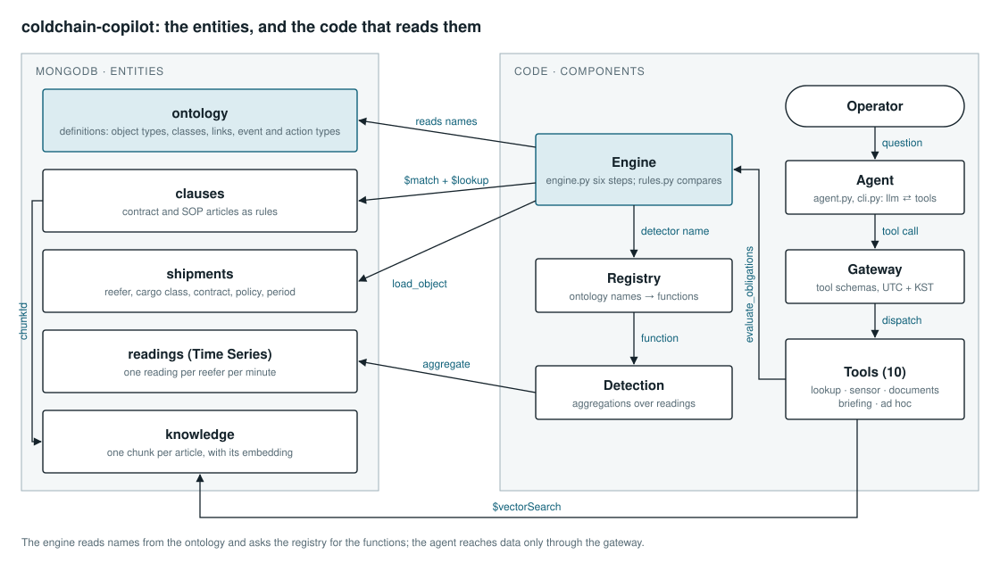
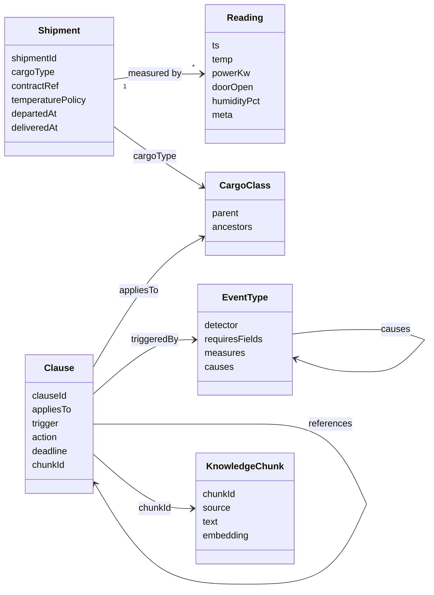
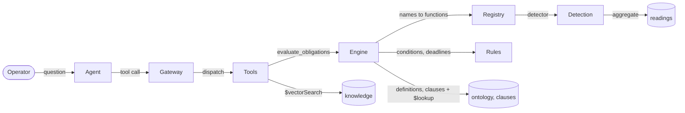
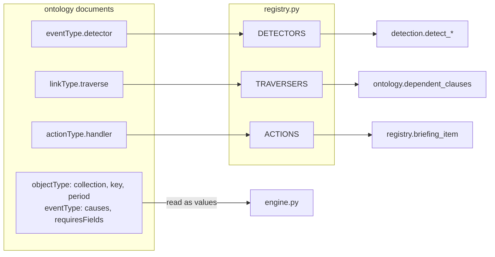

# Architecture

**Answers:** what is in the system, and how the parts work together.
**Read first:** [README](../README.md). **Next:** [walkthrough.md](./walkthrough.md) follows one question through these parts.

The system has two halves. **Entities** are data in MongoDB: shipments, sensor readings, rule-form clauses, document chunks, and the ontology that defines them all. **Components** are code that reads those entities and decides what must be done. The ontology is where the two meet: it names the types, links, and functions, and the code looks those names up.

---

## Entities

What the system knows about. Every entity is a MongoDB document; the ontology defines its type.

A shipment is measured by readings and carries one cargo class. A clause applies to a cargo class (or its ancestors), waits for one event type, may build on another clause, and points to the exact chunk of document text it was written from.

| Entity | Collection | What it is | Read by |
|---|---|---|---|
| Shipment | `shipments` | One trip: reefer, cargo class, contract version, temperature policy, departure and delivery | `engine.load_object`, `get_shipment` |
| Reading | `readings` (Time Series) | One minute of one reefer: temperature, power, door, humidity; the policy is copied into `meta` | detectors in `detection.py` |
| Clause | `clauses` | A contract article or SOP section rewritten as a rule: event, conditions, action, party, deadline | `engine` (via `ontology.applicable_clauses`) |
| EventType | `ontology` | Something detectors find: temperature excursion, door opening, compressor stop, humidity breach, power anomaly | `engine.detect_events` |
| CargoClass | `ontology` | The cargo hierarchy, `cargo:seafood` down to `cargo:live_fish`, with ancestors stored | clause selection |
| KnowledgeChunk | `knowledge` | One article or section of a source document, with its embedding | `$lookup` from clauses, `$vectorSearch` |

`Reefer` and `Contract` are also object types in the ontology, so links can name them, but they have no collection: a reefer is a `reeferId`, a contract is a `contractId` and `version`.

All 34 ontology documents by kind

| Kind | Count | Ids |
|---|---|---|
| `objectType` | 5 | `Shipment`, `Reading`, `Clause`, `Reefer`, `Contract` |
| `class` | 7 | `cargo:seafood`, `cargo:live_seafood`, `cargo:frozen_seafood`, `cargo:live_fish`, `cargo:oyster`, `cargo:frozen_tuna`, `cargo:frozen_shrimp` |
| `linkType` | 6 | `rel:assignedTo`, `rel:governedBy`, `rel:hasClause`, `rel:appliesTo`, `rel:triggeredBy`, `rel:references` |
| `eventType` | 5 | `event:temperature_excursion`, `event:door_opening`, `event:compressor_stop`, `event:humidity_breach`, `event:power_anomaly` |
| `actionType` | 6 | `action:notify`, `action:inspect`, `action:hold`, `action:report`, `action:maintain`, `action:retrain` |
| `party` | 5 | `party:shipper.qa`, `party:shipper.logistics`, `party:ops.driver`, `party:ops.maintenance`, `party:ops.qa` |

Field-level definitions: [ontology.md](./ontology.md). Document schemas: [entities.md](./entities.md).

---

## Components

The code that works on those entities, and what each part hands to the next.

The agent never calls the engine directly; it asks the gateway for a tool by name. The engine never names a detector in code; it reads the name from the ontology and asks the registry for the function.

| Component | Code | Responsibility |
|---|---|---|
| Agent | `agent.py`, `cli.py` | LangGraph `StateGraph` (llm ⇄ tools), conversation saved in MongoDB, answer streamed to the terminal |
| Gateway | `tools/gateway.py` | The LLM's only door: tool schemas, dispatch, errors as `{"error": ...}`, times as UTC plus a KST display string |
| Tools | `tools/*.py` | Ten read-only tools: lookup, sensor, documents, fleet briefing, obligations, and one guarded ad hoc aggregation ([interfaces.md](./interfaces.md)) |
| Engine | `engine.py` | Evaluates one shipment in six steps: object, clauses, detect, compare, follow, act |
| Registry | `registry.py` | Function names used in the ontology mapped to Python functions |
| Detection | `detection.py` | Events from readings by aggregation: runs of matching readings, and trends against a baseline |
| Rules | `rules.py` | Compares clause conditions with measures; computes deadlines; resolves chained clauses |
| Catalog | `catalog.py` | Checks before seeding that every name the data uses is defined: the ontology's grammar checker |

---

## Where the ontology meets the code

The ontology holds names, never logic. Code meets it in two ways.

- **Function names** (`detector`, `traverse`, `handler`) go through the registry. Swapping an implementation, for example following `rel:references` in a graph database, means registering a different function under the same name.
- **Values** (an object type's collection, key, and period fields; an event type's causes and required fields) are read by the engine directly. No code names the `shipments` collection or the `departedAt` field.

`catalog.py` checks both before seeding: every function name is registered, and every name a definition or clause uses is defined.

---

## Layers

Imports go downward only, and the agent reaches data only through the gateway. `tests/unit/test_layers.py` checks both on every run.

| Layer | Modules | May import |
|---|---|---|
| agent | `agent`, `cli` | tools (the gateway only), common |
| tools | `tools/*` | engine, common |
| engine | `engine`, `ontology`, `registry`, `detection`, `rules`, `catalog`, `ingest` | common |
| common | `config`, `db`, `errors`, `embeddings` | nothing in the package |

The chat model and the embedding model are chosen in `.env` (`LLM_MODEL`, `EMBEDDING_PROVIDER`); their SDKs are imported only in `agent.py` and `embeddings.py`. The full rule set is in [decisions.md § 7](./decisions.md).

---

## Kernel and domain

Which code a second domain (for example, pharmaceutical cold chain) would reuse as is, and which it would replace. Today both live in one package; the split waits for that second domain.

| Module | Kernel (reused) | Domain (cold chain) |
|---|---|---|
| `engine.py` | the six steps, `load_object`, `detect_events`, `attach_sources` | — |
| `rules.py` | all | — |
| `registry.py` | the structure | the registered functions |
| `ontology.py` | `ontology_docs`, `dependent_clauses` | `applicable_clauses` (contract and cargo rules) |
| `detection.py` | `run_pipeline`, `trend_pipeline`, `attach_causes` | the five `detect_*` functions |
| `catalog.py` | name-resolution checks | `chunkId` format, `cargo_specs` |
| `ingest.py` | chunking, embedding, index | the `Article` / `Section` heading pattern |
| `tools/` | `gateway`, `documents`, `briefing`, `adhoc` | `sensor`, `lookup` |
| `agent.py` | graph, streaming, history limit | the system prompt and briefing format |
| `data/` | — | `ontology.json`, `clauses.json`, `shipments.json` |

---

## Where to go next

| To learn | Read |
|---|---|
| How one question moves through these parts | [walkthrough.md](./walkthrough.md) |
| Every ontology field, measure, and the rule format | [ontology.md](./ontology.md) |
| Collections, document schemas, chunking | [entities.md](./entities.md) |
| Each tool's parameters and results | [interfaces.md](./interfaces.md) |
| Why it is built this way | [decisions.md](./decisions.md) |
