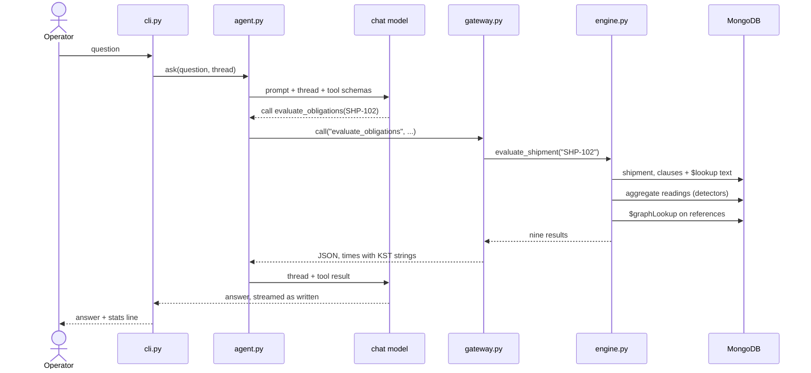
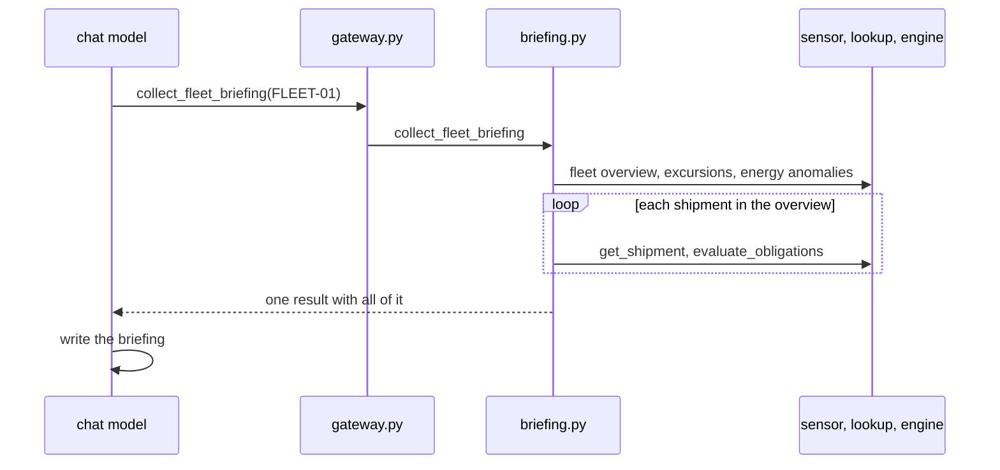

# Walkthrough: One Question

**Answers:** what actually happens, in order, when an operator asks a question.
**Read first:** [architecture.md](./architecture.md) for the parts named here.

The question:

> Who must SHP-102 notify, and by when?

SHP-102 is live fish (`cargo:live_fish`) in reefer RF-02 under the BlueHarbor contract, v1. In the seeded data its compressor stops for 30 minutes and the temperature rises above 4 °C for 24 minutes.



Two model calls and one tool call. The model decides which tool to call and writes the answer; every number, status, and deadline in the answer comes from the engine.

---

## 1. The agent asks the model what to do

`cli.py` passes the question to `agent.ask`, which runs the LangGraph graph for the thread. The `llm` node sends the model three things:

- the system prompt, with the current time from the run's `Context`;
- the thread so far, with tool results from the last three questions only (older ones are replaced by a short "omitted" note, so a long session does not outgrow the model's context);
- the ten tool schemas from `gateway.SCHEMAS`.

The prompt says that any question about what must be done, by whom, or by when goes to `evaluate_obligations`. The model replies with that tool call and no text.

## 2. The gateway runs the tool

The `tools` node hands the call to `gateway.call("evaluate_obligations", {"shipment_id": "SHP-102"})`. The gateway looks the name up in `FUNCTIONS` and calls `briefing.evaluate_obligations`, which calls the engine.

## 3. The engine decides every applicable clause

`engine.evaluate_shipment("SHP-102")` runs six steps. Each reads a name or value from the ontology and asks MongoDB one thing.

| Step | Reads from the ontology | Asks MongoDB | For SHP-102 |
|---|---|---|---|
| 1. Object | `Shipment`: collection, key, period | `shipments.find_one` | RF-02, live fish, BlueHarbor v1, in transit: the period runs from departure to now |
| 2. Clauses | `cargo:live_fish` and its ancestors | `clauses` `$match`, then `$lookup` on `knowledge` by `chunkId` | Nine clauses: BlueHarbor Art. 6, 7, 8; SOP § 2, 3, 4; manual § 2, 3, 4. Each with its source name and text |
| 3. Detect | each event type's `detector`, `requiresFields`, `causes` | `readings` aggregation, once per detector | One excursion: above, 24 min, peak about 8.2 °C. A 30-minute compressor stop overlaps it, so `cause` is `cause:compressor_stop` |
| 4. Compare | (conditions are in the clauses) | — | Art. 6: 24 ≥ 15 consecutive minutes, **triggered**, deadline 60 min after the start. Art. 8: 24 < 30 cumulative minutes, not triggered |
| 5. Follow | `rel:references` → `follow_references` | `$graphLookup` on `clauses.references` | Art. 7 references Art. 6, so Art. 6 `follows: [art7]`, and Art. 7 is triggered with it |
| 6. Act | each action type's `handler` | — | Five briefing items, one per triggered clause |

Nothing is stored. The next call aggregates the readings again, so a corrected reading changes the next answer.

<details>
<summary>The result for Art. 6, as the model receives it</summary>

```js
{ clauseId: "blueharbor-live-fish-v1-art6", kind: "obligation", status: "triggered",
  action: { type: "notify", party: "shipper.qa" },
  deadline: "2026-11-24T04:36:00Z", deadlineLocal: "2026-11-24 13:36 KST",
  basis: [{ measure: "direction", op: "eq", required: "above", actual: "above", met: true },
          { measure: "consecutiveMinutes", op: "gte", required: 15, actual: 24, met: true }],
  event: { eventType: "event:temperature_excursion", reeferId: "RF-02",
           start: "...", startLocal: "2026-11-24 12:36 KST", end: "...", endLocal: "2026-11-24 12:59 KST" },
  chunkId: "blueharbor-live-fish-v1-article-6",
  source: "BlueHarbor Fisheries Live Fish Transport Contract § Article 6",
  text: "Article 6: Notification of Temperature Excursion\n\nIf the internal temperature exceeds 4°C ...",
  follows: ["blueharbor-live-fish-v1-art7"] }
```

Times depend on when `scripts/seed.py` ran; the seed places the incidents relative to that moment.

</details>

The rules behind each step are in [ontology.md § 5](./ontology.md#5-execution-enginepy).

## 4. The gateway shapes the result

The engine returns `datetime` values and an `actions` list. `briefing.evaluate_obligations` drops `actions`, because each item repeats a triggered result. The gateway then turns the result into JSON: times become UTC strings, and every `start`, `end`, and `deadline` gets a `...Local` string in KST next to it. The model quotes those strings and never converts time zones.

## 5. The model writes the answer

The `llm` node runs again with the tool result in the thread. The model writes the answer from `basis` (fact against condition), `deadlineLocal`, and `text`, and cites `source`. Its text is streamed: `agent.ask` passes each piece to the CLI as it is generated, so the operator sees the answer start before it is finished.

> SHP-102 must notify the shipper's QA team by phone and email by 13:36 KST, one hour after the excursion started: 24 min ≥ 15 min above 4 °C. [BlueHarbor contract, Art. 6]

The CLI then prints one stats line, for example:

```text
── 8.4s (LLM 8.4s, tools 0.0s, first text 4.0s) · LLM 2 · tokens 6,277 in / 217 out · tools 1 (evaluate_obligations×1) · errors 0
```

---

## Other questions take the same loop

The graph is the same for every question. What changes is the tool the model chooses.

| Question | Tool the model calls | What the tool does |
|---|---|---|
| "Brief me on FLEET-01" | `collect_fleet_briefing` | Calls the fleet overview, excursions, energy anomalies, and each shipment's details and obligations in code, in one tool call |
| "What does the SOP say about door openings on frozen tuna?" | `search_knowledge` | `$vectorSearch` over `knowledge`, scoped to the shipment's contract or the cargo's procedures. Used when the document is not known in advance |
| "Average power of RF-04 per hour last night?" | `run_aggregation` | A pipeline the model writes, checked before it runs: only `readings`, `shipments`, or `cargo_specs`, no stage that writes or runs JavaScript, a time limit and a result limit |

A fleet briefing in detail:



The model asks once, so a briefing costs two model calls on every run. Left to choose tool by tool, it took three or four. Measurements: [refactoring.md, results 5.1 and 5.4](./refactoring.md).

---

## Follow-up questions

The thread is saved in MongoDB (`checkpoints`) under its `thread_id`. A follow-up such as "how long did RF-02's compressor stop?" is answered from the earlier tool results still in the thread, without calling a tool again. Results older than the last three questions are omitted from what the model sees; if it needs one, it calls the tool again.
