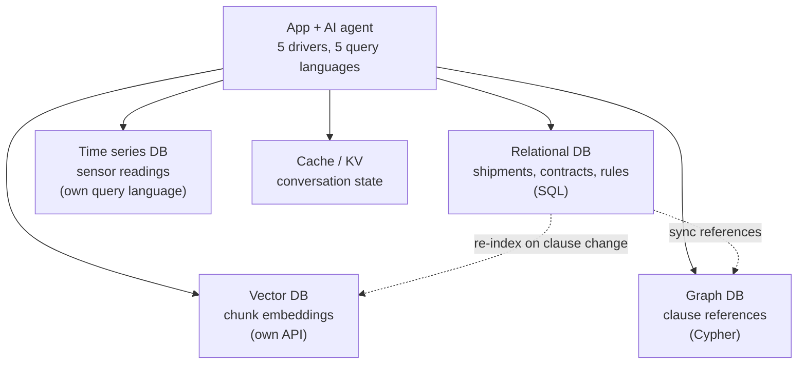
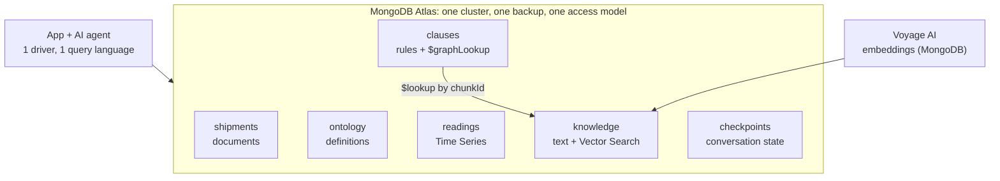
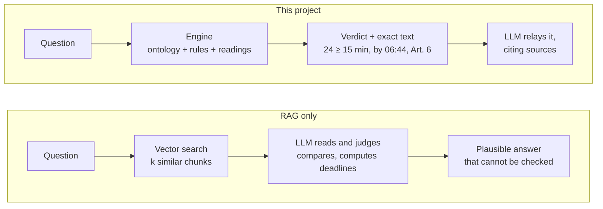
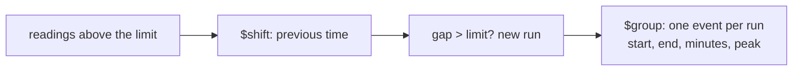
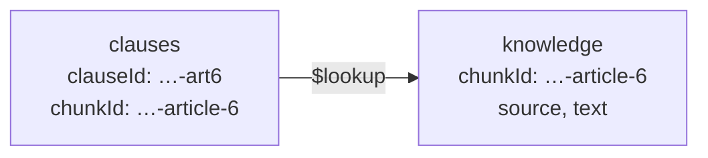
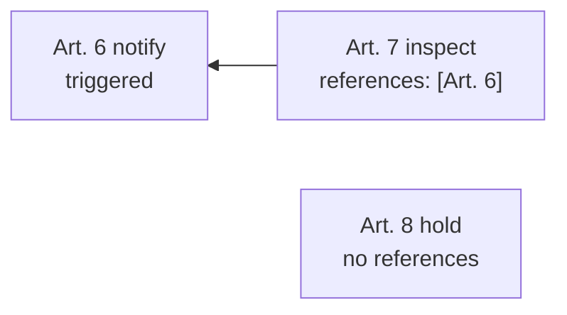

# Why MongoDB

**Answers:** what goes wrong when each kind of data gets its own database, why RAG alone cannot make these decisions, how each kind of data is modeled here and what MongoDB provides for it, and what MongoDB does not do.
**Read first:** [README](../README.md). **Next:** [entities.md](./entities.md) has every field; [decisions.md](./decisions.md) has the tradeoffs.

The copilot works with five kinds of data at once: sensor time series, contract rules, references between rules, document text for search, and agent conversations. The demo app's **Why MongoDB** tab tells the same story on screen.

1. [The usual setup, and this project's](#1-the-usual-setup-and-this-projects)
2. [Why RAG alone is not enough](#2-why-rag-alone-is-not-enough)
3. [Per kind of data: model and support](#3-per-kind-of-data-model-and-support)
4. [What MongoDB does here, and what it does not](#4-what-mongodb-does-here-and-what-it-does-not)

---

## 1. The usual setup, and this project's

The usual way to build this is one specialized store per kind of data:



This project keeps the same kinds of data apart as collections in one cluster:



What the first setup costs, and what changes here:

| Concern | With five stores | Here |
|---|---|---|
| **Operations** | Five deployments, backups, monitoring setups, upgrades, and incident playbooks. The team has to know five systems. | One cluster to run. |
| **Synchronization** | A changed clause must be re-synced into the vector and graph stores. If one lags, the verdict uses the new clause while the evidence search returns the old one. | Clauses and their text live in one database; nothing to sync. |
| **Consistent evidence** | Verdict and evidence come from different systems at different moments, which is hard to explain in an audit. | The verdict and its text come from one query. |
| **Cost** | Infrastructure and licences per system; the same clause stored three times; people learn five systems. | Each clause is stored once. |
| **Security and access** | "Only this shipper's contract" is implemented five times, in five access models. | The search filter and access live in one model. |
| **Latency** | One question crosses several systems; round trips add up. | A verdict is computed inside one database. |

---

## 2. Why RAG alone is not enough

RAG finds passages that look like the question and lets the LLM decide from them. For "what must RF-02 do?", the two approaches differ like this:



| Limit of RAG alone | What goes wrong | How this project handles it |
|---|---|---|
| **It finds similar text; it does not decide** | Search finds the "notify on excursion" clause but cannot say whether its condition holds now. Comparisons and deadlines left to the LLM can be wrong without anyone noticing. | The engine compares conditions and computes deadlines in code (`rules.py`). |
| **It never sees the sensor data** | The clause says "15 consecutive minutes"; how long it actually was is not in any document. | Events are computed from `readings` with aggregation. |
| **The wrong clauses get mixed in** | Another shipper's contract or an old version comes back because it is similar. | Applicable clauses are selected by contract version and cargo class. |
| **Links between clauses break** | Chunking separates "if Art. 6 applies, inspect before unloading" from Art. 6. If search misses Art. 7, an action goes missing. | `references` is followed with `$graphLookup`. |
| **The same question gets different answers** | A small change in search hits changes the judgment, and the answer cannot be reproduced. | The same data gives the same verdict, and the engine records a trace. |
| **It cannot say "there is no data"** | With no humidity sensor, search still returns something and the LLM answers plausibly. | Missing data is reported as `unresolved` ("needs confirmation"). |

Vector search is still used, for what it is good at: finding wording when nobody knows which document holds it ("how long may the door stay open while unloading tuna?").

---

## 3. Per kind of data: model and support

Each part follows the same four steps: the **problem** in this domain, how the data is **modeled**, what **MongoDB provides** for that model, and the **result**.

### 3.1 Sensor time series

**Problem.** Reefer sensors report every minute. Contract conditions depend on order and continuity: "above 4 °C for 15 consecutive minutes."

**Model.** One reading is one document. Which shipment, which reefer, and the allowed range at that moment go in `meta` (Extended Reference pattern). Incidents are not stored; they are computed from readings when a question needs them.

```js
{
  ts: ISODate("2026-11-25T05:44:00Z"),
  meta: {
    shipmentId: "SHP-102", reeferId: "RF-02", fleetId: "FLEET-01",
    temperaturePolicy: { minC: 0, maxC: 4 }
  },
  temp: 4.2, powerKw: 0.01, doorOpen: false
}
```

**MongoDB provides.**
- **Time Series collections:** with `timeField` and `metaField` set, readings are bucketed by time and compressed internally.
- **`$setWindowFields` with `$shift`:** each sorted reading gets the previous reading's time, so a gap starts a new run, inside the database (`detection.run_pipeline`).
- **Indexes on `meta`:** one shipment over one period reads fast.



**Result.** No incident table and no batch job to fill it. A corrected reading changes the next verdict immediately.

### 3.2 Contract rules

**Problem.** Clauses come in different shapes: two conditions, one that follows another clause, a recommendation with no deadline.

**Model.** One clause is one document in its own shape: condition (`trigger`), action (`action`), deadline (`deadline`), and where its text is (`chunkId`).

```js
// two conditions, with a deadline
{ trigger: { eventType: "event:temperature_excursion",
             allOf: [{ measure: "direction", op: "eq", value: "above" },
                     { measure: "consecutiveMinutes", op: "gte", value: 15 }] },
  deadline: { anchor: "eventStart", offsetMinutes: 60 } }

// follows another clause
{ trigger: { clauseTriggered: "blueharbor-live-fish-v1-art6" },
  action: { type: "inspect", before: "unloading" },
  references: ["blueharbor-live-fish-v1-art6"] }

// a recommendation with no contract and no deadline
{ contractId: null, kind: "recommendation", appliesTo: ["cargo:seafood"],
  trigger: { eventType: "event:door_opening" } }
```

**MongoDB provides.**
- **Flexible schema (polymorphic documents):** documents with different fields share one collection; JSON Schema validation can be added when needed.
- **Multikey indexes:** array fields such as `appliesTo` are indexed per element.

**Result.** A new kind of contract needs no new or changed tables, and reading a rule needs no join.

### 3.3 Ontology

**Problem.** Knowledge such as "shipments live in `shipments` and their period runs from `departedAt` to `deliveredAt`" or "a compressor stop can cause a temperature excursion", scattered through the code, means a code change for every change.

**Model.** Types, links, events, and actions are documents in `ontology`. They hold names and connections, not logic: a function is referenced by name and looked up in `registry.py`. Each cargo class stores its ancestors.

```js
{ _id: "Shipment", kind: "objectType",
  collection: "shipments", key: "shipmentId",
  period: { start: "departedAt", end: "deliveredAt" } }

{ _id: "event:temperature_excursion", kind: "eventType",
  detector: "detect_temperature_excursion",
  causes: ["event:compressor_stop", "event:door_opening"] }
```

**MongoDB provides.**
- **The same database as the data:** the engine reads a definition, then the data, over one connection.
- **Arrays with `$in`:** stored ancestors find "clauses for all seafood" in one query.

**Result.** Change a definition and the engine follows (rule B3 in [decisions.md](./decisions.md)). Another domain, such as pharmaceutical cold chain, can reuse the engine with different definitions.

### 3.4 Verdict and source text

**Problem.** "Notify by 06:44" needs the contract text it rests on. Finding that text by search risks returning a similar but different clause.

**Model.** One clause = one text chunk. The clause names its chunk exactly with `chunkId`.



**MongoDB provides.**
- **`$lookup`:** inside the aggregation that selects applicable clauses (`ontology.applicable_clauses`), the text from `knowledge` is joined by key.
- A sub-pipeline keeps only `source` and `text`.

**Result.** The verdict and its text come from one query. The evidence is always exactly that clause, and the LLM makes no extra tool call to fetch it.

### 3.5 Clause references

**Problem.** Clauses reference clauses: when Art. 6 triggers, Art. 7 (inspect before unloading) applies too. From a triggered clause, every clause that follows must be found.

**Model.** A following clause points to the clause it relies on in a `references` array (Art. 7 → Art. 6).



**MongoDB provides.**
- **`$graphLookup`:** follows `references` backwards within `clauses` over several hops; `maxDepth` bounds the walk and `depthField` records the hop (`ontology.dependent_clauses`).

**Result.** References this shallow (one or two hops) are walked where the rules live, without a separate graph database.

### 3.6 Document search

**Problem.** "How long may the door stay open while unloading tuna?" No one knows which document answers it, and another shipper's contract must never be shown as evidence.

**Model.** Each chunk holds its text, its embedding, and whose document it is (`contractId`, `version`, `docType`, `appliesTo`).

```js
{ chunkId: "sop-excursion-response-v1-section-3",
  source: "Temperature Excursion Response SOP § 3",
  text: "A door left open for more than 10 …",
  embedding: [0.013, -0.087, …],          // voyage-4, 1,024 dimensions
  docType: "sop", contractId: null, appliesTo: ["cargo:seafood"] }
```

**MongoDB provides.**
- **Voyage AI:** MongoDB's embedding models put chunks and questions into the same vector space.
- **`$vectorSearch`:** finds the chunks closest in meaning.
- **`filter`:** narrows by metadata inside the search stage, keeping only the shipment's contract version and its cargo's SOPs (`documents.knowledge_filter`).

**Result.** Embedding, vector storage, and search come from one stack, and semantic search and access scoping are one query. No separate vector store, no sync.

### 3.7 Conversation state

**Problem.** A follow-up such as "can the shipper refuse delivery, then?" needs the earlier question and tool results.

**Model.** Each thread's messages and tool results are saved as checkpoint documents.

**MongoDB provides.** LangGraph's `MongoDBSaver` stores them in the same cluster: `MongoDBSaver(db.get_client(), db_name=settings.db_name)`.

**Result.** Conversations sit under the same backups and access as the operational data.

---

## 4. What MongoDB does here, and what it does not

Putting everything in the database is not the goal. Each job sits where it can be done and checked best.

| MongoDB does | How |
|---|---|
| Store operational data | Shipments, contract clauses, ontology definitions |
| Sensor time series and incidents | Store readings; aggregate runs and trends |
| Look up and connect facts | Select applicable clauses, join their text (`$lookup`), follow references (`$graphLookup`) |
| Create embeddings | Voyage AI (voyage-4) turns chunks and questions into vectors, called as an API rather than inside the database engine |
| Semantic search | `$vectorSearch` over chunks, with access filters |
| Agent state | Messages and tool results per conversation |

| MongoDB does not | Who does | Why |
|---|---|---|
| Understand questions, write answers | LLM | It chooses tools and writes results as text. |
| Decide whether a clause triggers | Application code (`rules.py`) | The database computes the facts (24 minutes); the decision (24 ≥ 15, so it triggers) stays in code that can be tested. |
| Carry out actions | Business systems | No notices are sent and no work orders opened; the demo is read-only. |
| Collect sensor data | IoT gateway, streaming | Getting data off the equipment is out of scope; the demo seeds 72 hours. |
| Large, deep graph analytics | Graph engine | Path search over millions of nodes or graph algorithms call for a dedicated engine. References here are one or two hops. |
